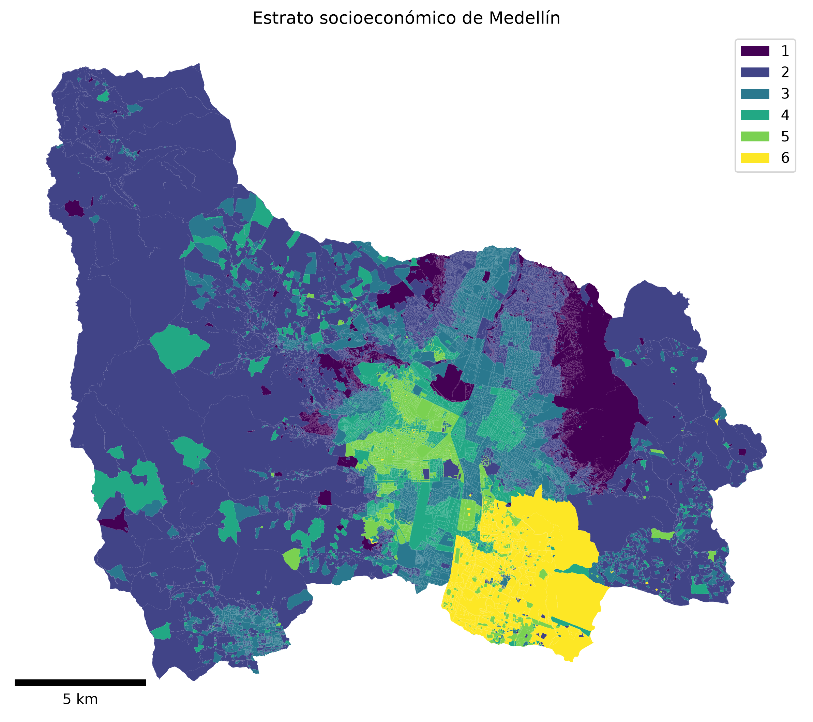

# Datos — Análisis Geoespacial (UNAL, 2026-II)

Archivos seleccionados como **resultados exploratorios de caracterización territorial de Medellín** para apoyar el proyecto del curso, cuyo propósito es estudiar posteriormente indicadores geoespaciales de movilidad y accesibilidad.

## Contenido

| Archivo | Descripción |
| --- | --- |
| `estrato_socioeconomico_medellin.png` | Mapa exploratorio de distribución de estratos socioeconómicos de Medellín. |
| `resumen_pendiente_por_estrato.csv` | Estadísticos de pendiente, expresados en **grados**, agrupados por estrato (1 a 6). |
| `distribucion_pendiente_por_estrato.csv` | Distribución porcentual de píxeles por intervalos de pendiente, agrupada por estrato. |
| `Visualizacion_exploratoria.ipynb` | Lectura y visualización de los CSV, usando rutas relativas dentro de esta carpeta. |

## Vista del mapa

## Origen y estado

- Los CSV se exportaron durante los ensayos del cuaderno de trabajo **`Estrato_Elevacion.ipynb`**, que permanece como bitácora local y no forma parte de esta selección.
- El análisis original utilizó polígonos de estratificación y un modelo digital de superficie (`MDS1_05001_20210501.tif`) con un procedimiento **experimental** de remuestreo y corrección de anomalías. Las pendientes de los CSV proceden de un ráster de análisis con celdas de aproximadamente 20 m, no de un modelo de terreno desnudo validado.
- Los datos originales de entrada y sus metadatos/licencias **aún deben documentarse y verificarse**. Los archivos aquí incluidos no bastan para reconstruir todo el procesamiento original.
- El notebook incluido **sí permite reproducir la lectura, tablas y gráficos de estos CSV**, pero **no** recalcular el análisis desde los rásteres originales.

## Precauciones de interpretación

Los valores son preliminares y **no deben interpretarse como pendientes viales**, ni como indicadores directos de accesibilidad o movilidad. No se ha validado que las correcciones remuevan completamente edificios, vegetación u otras anomalías del modelo de superficie. Tampoco debe inferirse una relación causal entre estrato y pendiente a partir de estos resultados. Las categorías de pendiente de las tablas están expresadas en grados, no en porcentaje de inclinación.

## Próximo trabajo

Documentar y verificar las fuentes; incorporar red vial, transporte público, equipamientos e indicadores de accesibilidad; contrastar el relieve con un modelo de terreno adecuado antes de derivar indicadores relacionados con movilidad.
